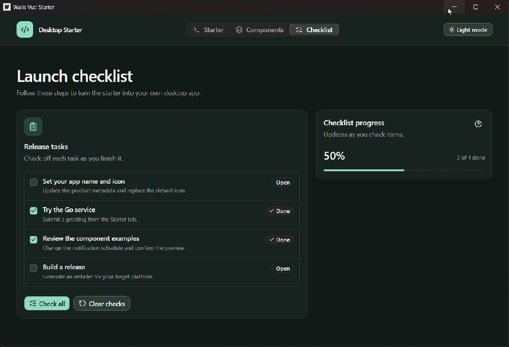

# Wails Vue Tailwind TypeScript

A Wails v3 desktop app template with a Go backend, Vue 3, TypeScript, Tailwind CSS v4, and editable shadcn-vue components.

## Install the sample app

Open the [latest release](https://github.com/vanam-san/wails-template-vue-tailwind/releases/latest) and expand **Assets**. Download the installer for your platform. The sample app includes the frontend and runs without a developer toolchain.

| Platform | Install |
| --- | --- |
| Windows x64 | Run `WailsVueStarter-amd64-installer.exe` and follow the setup wizard. The installer includes a WebView2 bootstrapper. |
| Debian 13 amd64 | From the download folder, run `sudo apt install ./wailsvuestarter.deb`. |
| macOS (Apple silicon or Intel) | Open `wailsvuestarter.dmg` and drag the app into **Applications**. |

## Try the app

1. Open **Wails Vue Starter**. On **Starter**, enter a name and select **Greet from Go**. Check the **Go response** panel for the reply.
2. Open **Components**, change the notification schedule, then select **Review preferences** and **Confirm**. The preview updates as you change the controls.
3. Open **Checklist** and check off a task to update the progress bar. Use the theme button in the header to switch between light and dark mode.

## Screenshot



## Create your own app

Install Go 1.26 or newer, Bun 1.4.5, Node.js 24 or 26, and the [Wails platform dependencies](https://v3.wails.io/getting-started/installation/). Put Go's executable directory on your PATH so the installed `wails3` command is available.

```sh
go install github.com/wailsapp/wails/v3/cmd/wails3@v3.1.0
wails3 doctor
wails3 init -n WailsVueStarter -t https://github.com/vanam-san/wails-template-vue-tailwind@master -mod example.org/wails/starter -productname "Wails Vue Starter"
cd WailsVueStarter
wails3 dev
```

Replace `example.org/wails/starter` with your own Go module path. Run `wails3 build` from the generated app to build the executable in `bin/`.

- [Development](docs/DEVELOPMENT.md) covers Docker, local template changes, and checks.
- [Compatibility and dependency maintenance](docs/COMPATIBILITY.md) lists tested toolchains, platform requirements, and dependency checks.
- [Build and release](docs/BUILD_AND_RELEASE.md) covers packaging and publishing.
- [Architecture](docs/ARCHITECTURE.md) maps the source files and traces a greeting from Vue to Go.
- [Troubleshooting](docs/TROUBLESHOOTING.md) covers common setup and integration problems.
- [Contributing](CONTRIBUTING.md), [changelog](CHANGELOG.md), and [MIT license](LICENSE).

README structure inspired by [Wails Template Vue](https://github.com/misitebao/wails-template-vue). Codex and OpenCode were used during development.
