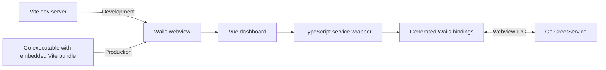

# Architecture

Go owns application services and native integrations. Vue owns presentation, form state, and feedback. The example service trims and validates input in Go so validation holds for every caller. The Vue composable also checks blank entries for immediate feedback and guards against duplicate requests.

Wails registers the Go service in `main.go` and its binding generator discovers the exposed methods. At initialization the template renders the actual Go module path into the app-owned wrapper. The generated client follows that module path under `frontend/bindings/` and calls the Wails runtime bundled with the frontend. Regenerate the files after changing the service. Manual edits would be overwritten.

During development Wails proxies the loopback Vite server and watches Go files. Vite handles Vue hot reload. In production, the Wails asset server serves the contents of `frontend/dist/` from the Go executable. The Docker desktop viewer sends native Linux window pixels and input through noVNC. Vite and Wails IPC remain inside the container.

## Where to make changes

| Change | Files to start with |
| --- | --- |
| Native window title, dimensions, or registered services | `main.go.tmpl` in the template and `main.go` in the generated app |
| Greeting text or server-side validation | `greetservice.go` and `greetservice_test.go` |
| Greeting form feedback or request state | `frontend/src/views/HomeView.vue` and `frontend/src/composables/useGreeting.ts` |
| Tab navigation or remembered theme | `frontend/src/App.vue` |
| Shared colors, typography, or UI primitives | `frontend/src/style.css` and `frontend/src/components/ui/` |
| Development port or Docker file watching | `Taskfile.tmpl.yml`, `frontend/vite.config.ts`, and `compose.yml` |

## Trace a greeting

1. The form in `HomeView.vue` passes the name to `useGreeting`. The composable clears previous feedback, checks for blank input, and guards against another submission while a request is pending.
2. The composable calls the app-owned `greet` wrapper. In the generated app, the wrapper imports the binding from `frontend/bindings/<go-module>/greetservice.js`. In TypeScript source, the `.js` extension names the runtime module that the generated TypeScript provides.
3. The generated binding calls `GreetService.Greet`. Go trims and validates the name again, then returns the greeting or an error. The composable drives the form's response, error, and status from that result.

To test the form logic without launching the desktop window, inject a promise-returning function as shown in `useGreeting.test.ts`. The Go tests call the service directly so they can check its behavior independently of the form.

## State in the sample screens

The Components preferences and Checklist progress stay in Vue memory. The Components tab updates a preview as its controls change. Confirm shows a status message. Tab panels stay mounted when hidden, keeping their state until the webview reloads. The light or dark theme persists through webview local storage after the user selects it.

The UI wrappers apply Tailwind styles to Reka UI primitives. When editing a wrapper, preserve its forwarded props and events so features such as `v-model`, dialog focus management, and keyboard navigation continue to work.
