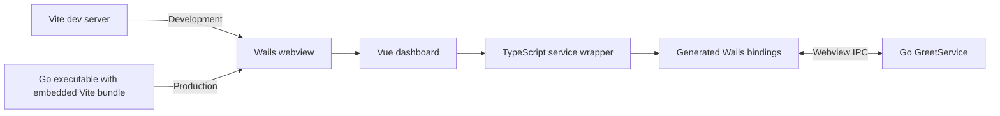

# Architecture

Go owns application services and native integrations. Vue owns presentation, form state, and feedback. The example service trims and validates input in Go so validation holds for every caller. The Vue composable also checks blank entries for immediate feedback and guards against duplicate requests.

Wails registers the Go service in `main.go` and its binding generator discovers the exposed methods. At initialization the template renders the actual Go module path into the app-owned wrapper. The generated client follows that module path under `frontend/bindings/` and calls the Wails runtime bundled with the frontend. Regenerate the files after changing the service. Manual edits would be overwritten.

During development Wails proxies the loopback Vite server and watches Go files. Vite handles Vue hot reload. In production, the Wails asset server serves the contents of `frontend/dist/` from the Go executable. The Docker desktop viewer sends native Linux window pixels and input through noVNC. Vite and Wails IPC remain inside the container.

The Components tab is a self-contained Vue example. Its sample preferences exercise local primitives and update an in-app preview.
